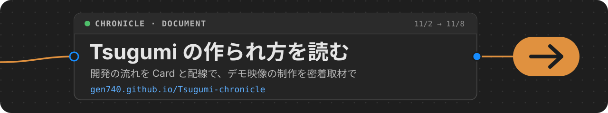

  

# Tsugumi Chronicle

How [Tsugumi](https://github.com/gen740/Tsugumi) was built by one person and Claude during the Claude Hackathon 2026, told as a short build log.

Read it at **https://gen740.github.io/Tsugumi-chronicle/**, or open `index.html` locally. It is a static page with no build step; the data is in `data/chronicle.js`, and GitHub Pages publishes `main` as it is.

## What this page contains

- A summary of each stage of development, with a takeaway for people trying the same approach.
- The three phases of the process: committing straight to `main`, handing over long review notes as Markdown files, and steering many small pull requests from one session.
- A documentary of how the demo film was made, from the first plot to the final check with the people interviewed.
- Counts and timestamps of commits, instructions and reports, and public GitHub facts (commit subjects, pull requests, releases), up to the v0.6.0 release.

## What it does not contain

The raw development sessions, review documents and progress notes are kept privately. They are not published here because it is not possible to guarantee that every message is free of personal information or credentials. The summaries were written by Claude from those records; reports from Claude are records of what was said, not independent verification.
